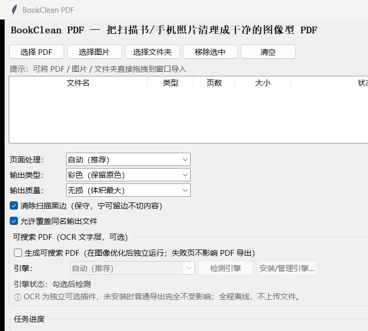

# BookClean PDF

把扫歪、泛黄、带黑边的图书扫描件，整理成干净、端正、清楚的 PDF。全程在本地电脑上完成，不联网、不上传。



## 它能做什么

- 清掉扫描背景的发灰、泛黄和噪点，让纸面变干净，但不动文字、脚注、页码和插图。
- 纠正轻微倾斜和拍摄变形；保守地裁掉扫描黑边，拿不准就保留，宁可留边也不切内容。
- 输出彩色或灰度 PDF，几档质量可选（体积优先 / 均衡 / 无损）。
- 可选 OCR：给 PDF 加一层看不见的文字，使其能搜索、能复制（需另装 OCR 插件，见下）。
- 大书不怕中断：中断后可续跑，已处理的页不重做；导出前逐页校验，个别坏页不毁整本。

原始文件始终只读，结果写到别处，不会覆盖你的扫描件。

## 下载与安装

到 [Releases](https://github.com/hepietou-dev/BookCleanPDF/releases/latest) 下载 `BookCleanPDF-1.0.0-setup.exe`（约 44 MB），双击按向导安装。

- 仅当前用户安装，不需要管理员权限。
- 不需要另装 Python，运行时已打包在内。
- 安装与运行都离线，不下载任何东西。

装好后从开始菜单启动：导入 PDF 或图片 → 选质量与色彩 → 开始处理 → 导出 PDF。
默认输出到「文档\BookCleanPDF」，可在界面里改。

## 可选：让 PDF 可搜索（OCR）

基础包不带 OCR 引擎；不装也完全不影响普通导出。需要搜索 / 复制文字时：

1. 在同一 Release 页下载 `ocr-rapid-1.4.4-plugin.zip`（约 103 MB，含独立运行时与模型）。
2. 在软件「设置 → OCR」点「打开插件目录」，新建 `ocr-rapid\1.4.4\` 文件夹，把 zip 内容解压进去，使该文件夹直接包含 `plugin.json` 和 `runtime\`。
3. 回面板点「检测引擎」，显示已就绪后勾选 OCR 即可。

插件是独立目录，可随时整目录删除或更新，不影响主程序。识别在本地子进程完成，不联网。

## 校验下载

Release 页附 `SHA256SUMS.txt`。PowerShell 里：

```powershell
Get-FileHash BookCleanPDF-1.0.0-setup.exe -Algorithm SHA256
```

## 卸载

通过「设置 → 应用」或安装目录里的卸载程序。只移除程序本身；你的任务数据（`%LOCALAPPDATA%\BookCleanPDF`）和已导出的 PDF 不会被删除。

## 从源码运行（开发者）

需要 Windows + Python 3.12：

```bat
python -m venv .venv
.venv\Scripts\python.exe -m pip install -r requirements-dev.txt
.venv\Scripts\python.exe app.py
.venv\Scripts\python.exe -m pytest
```

依赖的精确版本在 `requirements-lock.txt`。打包用 PyInstaller（`packaging/pyinstaller.spec`）加 Inno Setup（`packaging/installer.iss`）。

## 隐私

不上传文件、不联网检查更新、不自动下载模型、无遥测。日志只记运行状态，不记图像内容。

## 许可证

随包分发的第三方组件许可证见 `THIRD_PARTY_LICENSES/`。本项目源码暂未单独声明开源许可（默认保留所有权利）。
